# 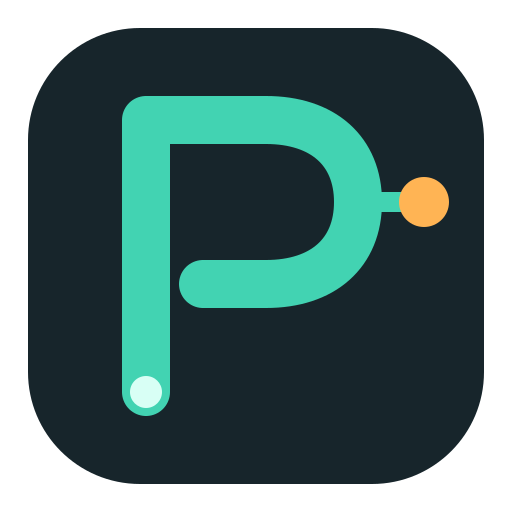 OpsPilot

> **ИИ-агент для эксплуатации, который понимает вашу инфраструктуру, находит первопричину и устраняет её — прямо из Slack или Telegram.**

*Метрики · логи · трейсы · радиус влияния топологии · корреляция первопричин · удалённое выполнение · автоматическое расследование по алертам · RAG-поиск по знаниям и коду · специализированные агенты и навыки.*

[](https://goreportcard.com/report/github.com/Zara1024/OpsPilot)
[](https://github.com/Zara1024/OpsPilot/releases/latest)
[](go.mod)
[](https://www.gnu.org/licenses/agpl-3.0.html)
[](#features)
[](CONTRIBUTING.md)
[](https://t.me/opspilotai)
[](https://join.slack.com/t/opspilot-co/shared_invite/zt-400skx7hz-WU1nmF1XVYH4S3Q1NfWrbw)

<p>
  <a href="https://trendshift.io/repositories/48061?utm_source=repository-badge&amp;utm_medium=badge&amp;utm_campaign=badge-repository-48061" target="_blank" rel="noopener noreferrer">
    
  </a>
</p>

[English](./README_EN.md) | [简体中文](./README.md) | [日本語](./README_JA.md) | [한국어](./README_KO.md) | [Español](./README_ES.md) | [Français](./README_FR.md) | [Deutsch](./README_DE.md) | [Português](./README_PT.md) | Русский

---

<p align="center">
  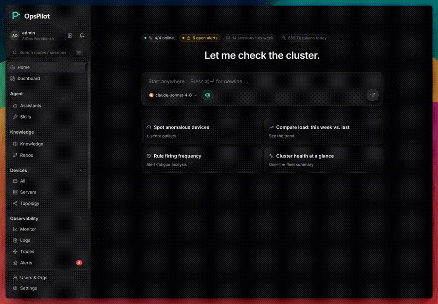
</p>

<p align="center">
  
  <br />
  <strong>☸️ Управление жизненным циклом Kubernetes уже доступно</strong><br />
  <sub>Подключайте кластеры через Edge, проверяйте нагрузки и события, управляйте обновлениями и связывайте ресурсы Kubernetes с топологией.</sub>
</p>

<div align="center">

[Возможности](#возможности) • [Установка](#установка) • [Интеграции](#интеграции) • [Лицензия](#лицензия)

</div>

## Возможности

- 🤖 **Агенты Coordinator + Specialist** — coordinator делегирует суб-агентам SRE / сеть / БД / активы
- 🚨 **Авто-исследование по алерту** — investigator запускает RCA-worker и пишет причину в чат
- 🔍 **Корневая RCA** — обходит топологию, коррелирует метрики/логи/трейсы, до строки исходного кода
- 🔒 **Ноль входящих портов** — edge выходит наружу; нет порта 22 / 80 / 443 на хосте
- 💻 **SSH в браузере** — оболочка через обратный туннель, без ключей, без jumpbox, в аудите
- 🐳 **Self-host одной командой** — `install.sh` поднимает весь стек
- 📊 **Встроенная observability** — Prometheus + Loki + Tempo + Grafana готовы, агент пишет запросы
- 🧠 **Принесите свою модель** — Anthropic / OpenAI / GLM / DeepSeek / Gemini / Kimi, горячая маршрутизация
- 💬 **Двусторонние IM-каналы** — Slack / Telegram / Larksuite / DingTalk / WeCom, локаль на канал
- 🛠️ **Read-only host-инструменты** — sandbox bash + 26+ инструментов, каждый вызов в аудите
- ☸️ **Жизненный цикл Kubernetes** — регистрируйте кластеры, проверяйте нагрузки и события, управляйте обновлениями и отражайте ресурсы в топологии
- 🌐 **Управление сетевыми устройствами** — обнаруживайте соседей с Edge-хостов, проверяйте через SNMP, опрашивайте интерфейсы и отображайте связи хост-устройство

## Установка

Скачайте последний релиз для архитектуры вашего сервера (`linux-amd64` или `linux-arm64`), распакуйте и запустите скрипт установки (Ubuntu 22.04+, Debian 12+, RHEL/Rocky 9):

Выберите команду для архитектуры вашего сервера:

**AMD64**
```bash
wget https://github.com/Zara1024/OpsPilot/releases/download/v1.1.4/opspilot-v1.1.4-linux-amd64.tar.xz
tar -xf opspilot-v1.1.4-linux-amd64.tar.xz && cd opspilot-v1.1.4-linux-amd64
sudo ./install.sh
```

**ARM64**
```bash
wget https://github.com/Zara1024/OpsPilot/releases/download/v1.1.4/opspilot-v1.1.4-linux-arm64.tar.xz
tar -xf opspilot-v1.1.4-linux-arm64.tar.xz && cd opspilot-v1.1.4-linux-arm64
sudo ./install.sh
```

**🇨🇳 Материковый Китай** — если GitHub медленный, используйте URL CDN-зеркала для вашей архитектуры:

```bash
# AMD64
wget https://opspilot.cloud/dl/opspilot-v0.18.2-linux-amd64.tar.xz

# ARM64
wget https://opspilot.cloud/dl/opspilot-v0.18.2-linux-arm64.tar.xz
```

## Обзор продукта

### Анализ первопричины

<p align="center">
  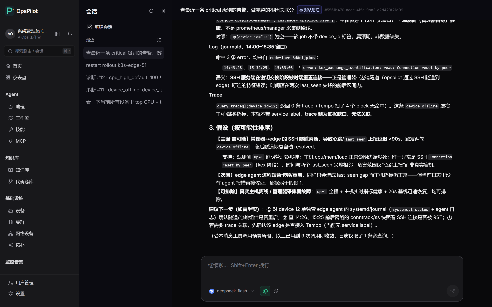
</p>

Начните с алерта или вопроса оператора и соберите топологию, устройства, метрики, логи и изменения для анализа с доказательствами.

### Конструктор workflow

<p align="center">
  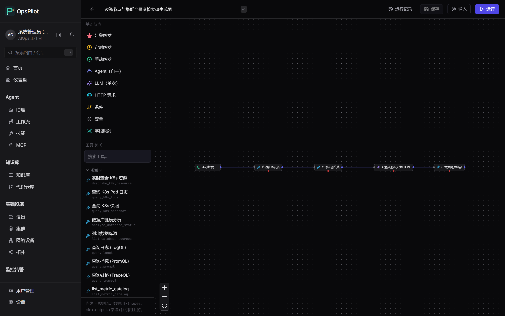
</p>

Связывайте триггеры, агентов, инструменты, условия и уведомления в повторяемые автоматизации.

### Каталог skills

<p align="center">
  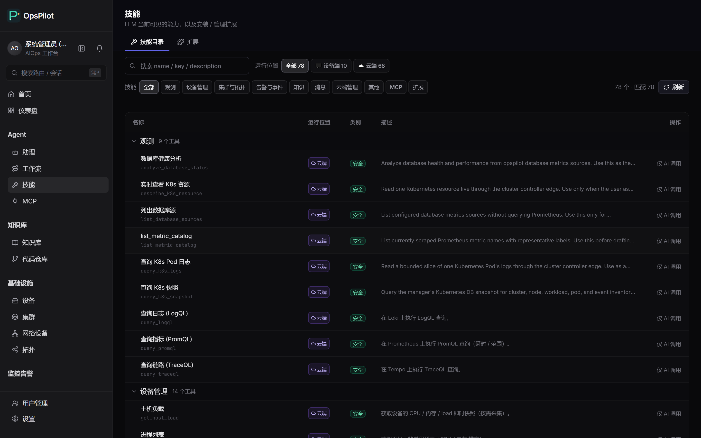
</p>

Показывайте инструменты, которые могут вызывать агенты, с описаниями и границами.

### MCP-серверы

<p align="center">
  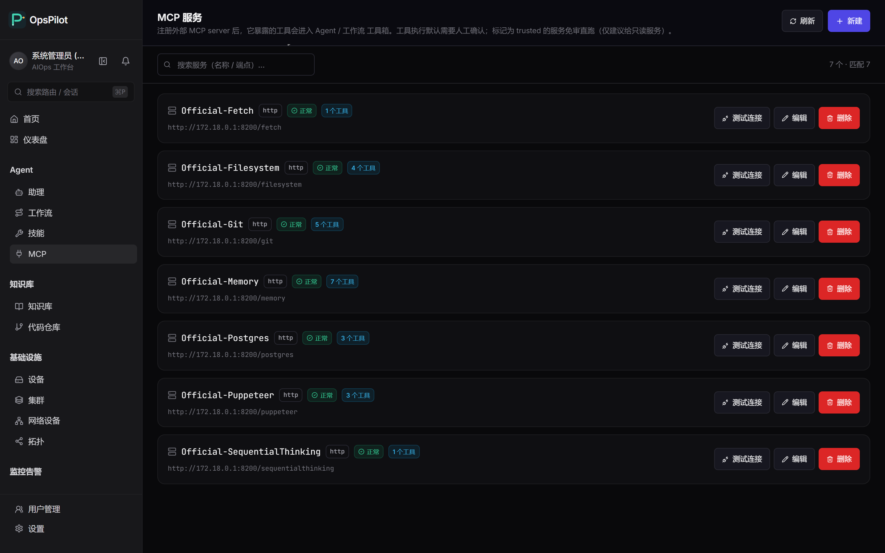
</p>

Регистрируйте внешние MCP-серверы и подключайте их инструменты к единому управляемому инвентарю.

### База знаний

<p align="center">
  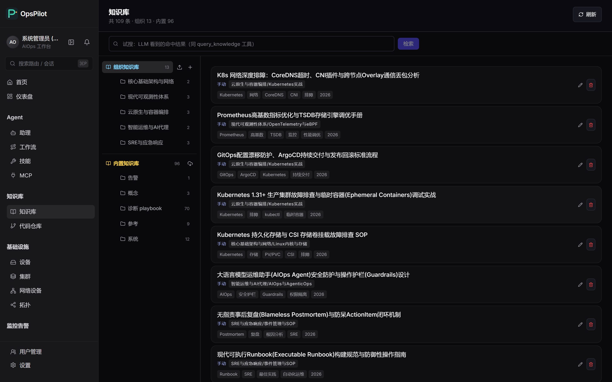
</p>

Индексируйте runbook-и, историю инцидентов, архитектурные заметки и репозитории как поисковый контекст.

### Центр артефактов

<p align="center">
  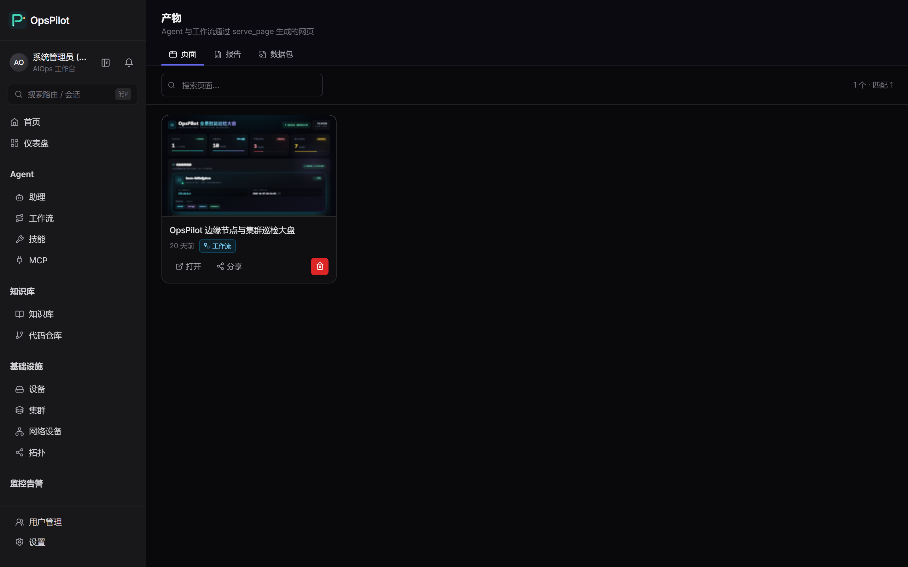
</p>

Храните созданные страницы и отчеты в одном центре, приватном по умолчанию.

### Мониторинг

<p align="center">
  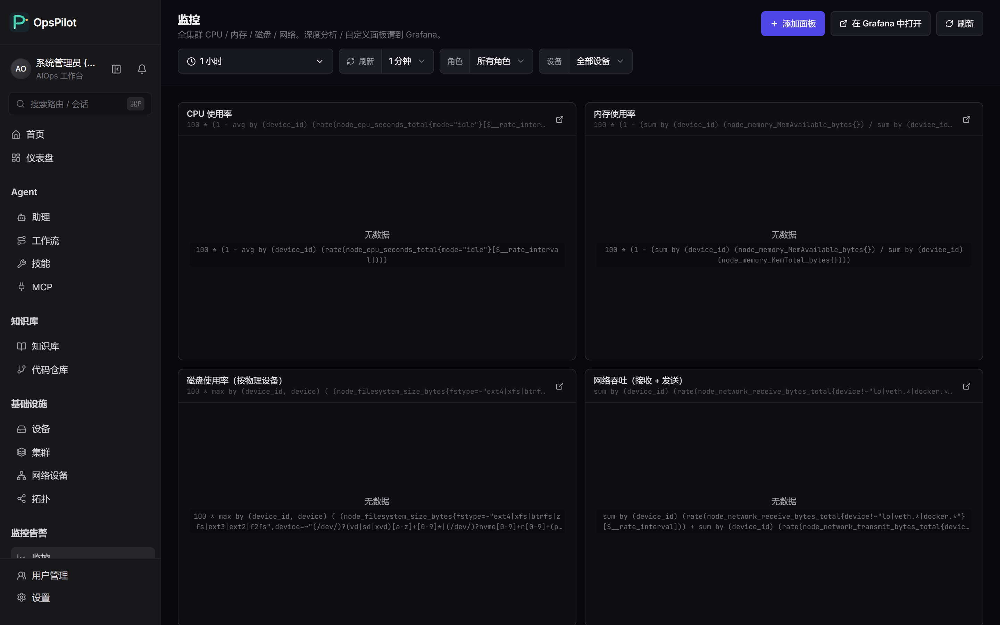
</p>

Проверяйте состояние флота, логи, трейсы и алерты в одном рабочем пространстве.

### Карта топологии

<p align="center">
  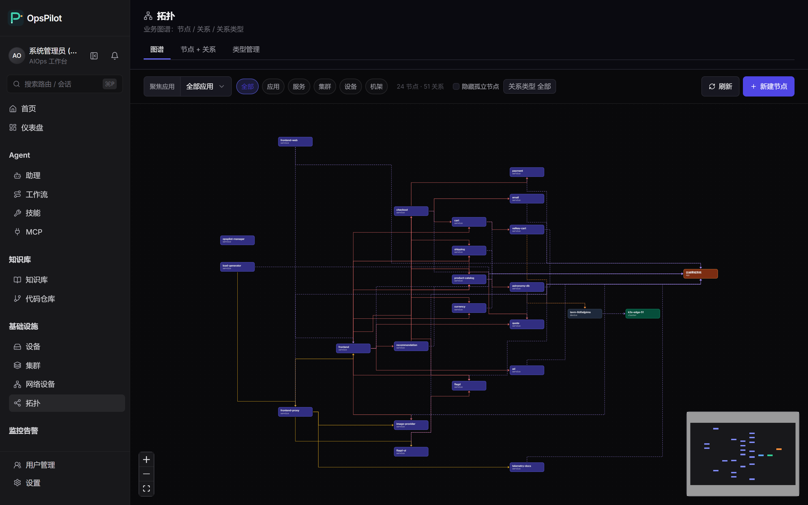
</p>

Визуализируйте зависимости и blast radius, чтобы отслеживать влияние инцидента.

### Согласование и write gate

<p align="center">
  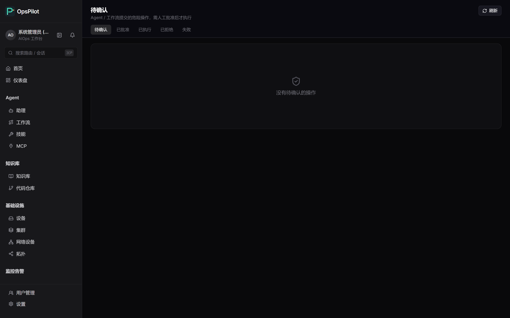
</p>

Держите рискованные действия за согласованиями и видимыми политиками.

## Интеграции

Подключается к стекам observability, каналов и моделей, которые ваша команда уже использует.

| | |
|---|---|
| **Observability** | &nbsp;&nbsp;&nbsp;&nbsp;&nbsp;&nbsp;&nbsp;&nbsp;&nbsp;&nbsp;&nbsp;&nbsp;&nbsp;&nbsp;&nbsp; |
| **Каналы** | &nbsp;&nbsp;&nbsp;&nbsp;&nbsp;&nbsp;&nbsp;&nbsp;&nbsp;&nbsp;&nbsp;&nbsp;&nbsp;&nbsp;&nbsp; |
| **Модели** | &nbsp;&nbsp;&nbsp;&nbsp;&nbsp;&nbsp;&nbsp;&nbsp;&nbsp;&nbsp;&nbsp;&nbsp;&nbsp;&nbsp;&nbsp; |

## Лицензия

AGPLv3 — см. [LICENSE](LICENSE).
